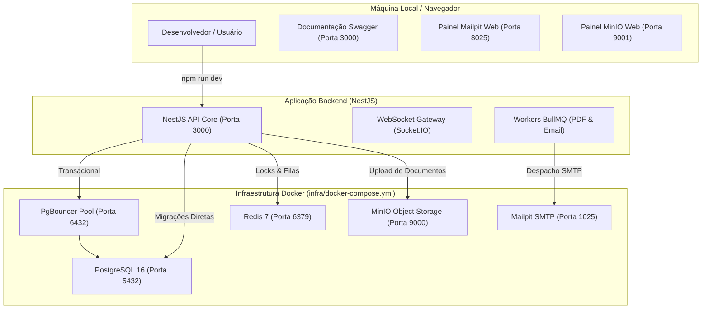

# Manual de Execução e Operação do Sistema (SIGA Universitário)

Este documento contém o guia normativo e as instruções detalhadas para configurar, inicializar e operar o ecossistema do **SIGA Universitário** (Sistema Integrado de Gestão Acadêmica - Angola).

---

## 1. Visão Geral da Arquitetura e Mapa de Portas

O sistema opera com um monólito modular de alta performance desenvolvido em NestJS, integrado a contêineres de serviços auxiliares orquestrados via Docker Compose.



### Mapa de Portas de Rede

| Serviço | Contêiner Docker | Porta Local | Protocolo | Descrição / Acesso |
| :--- | :--- | :--- | :--- | :--- |
| **API Backend NestJS** | Aplicação Local | `3000` | HTTP / WS | API REST e WebSockets (`/api/v1`) |
| **Documentação Swagger** | Aplicação Local | `3000` | HTTP | Interface interativa (`http://localhost:3000/api/docs`) |
| **PostgreSQL 16** | `siga-postgres` | `5432` | TCP | Banco de dados relacional principal |
| **PgBouncer** | `siga-pgbouncer` | `6432` | TCP | Pooler de conexões transacionais |
| **Redis 7** | `siga-redis` | `6379` | TCP | Cache, locks atômicos Lua e filas BullMQ |
| **MinIO API** | `siga-minio` | `9000` | S3 API | Armazenamento de arquivos e certidões |
| **MinIO Console** | `siga-minio` | `9001` | HTTP | Painel Web de administração dos buckets |
| **Mailpit SMTP** | `siga-mailpit` | `1025` | SMTP | Servidor de envio de e-mails de desenvolvimento |
| **Mailpit Web UI** | `siga-mailpit` | `8025` | HTTP | Interface Web para visualização de e-mails recebidos |

---

## 2. Pré-requisitos de Ambiente

Para a correta execução da plataforma em ambiente local, certifique-se de possuir instalado:

1. **Node.js**: Versão LTS 20.x ou superior (verificar com `node -v`).
2. **npm**: Versão 10.x ou superior (verificar com `npm -v`).
3. **Docker Engine & Docker Compose**: Versão 2.20 ou superior (ou Docker Desktop no Windows/macOS).

---

## 3. Inicialização Rápida (Quickstart)

Para inicializar todo o ambiente do zero, execute a sequência de passos descrita abaixo.

### Passo 1: Clonar o repositório e preparar as variáveis de ambiente
Na raiz do repositório, copie o arquivo de exemplo para gerar o arquivo `.env`:

```bash
# No Windows PowerShell:
Copy-Item backend/.env.example backend/.env

# No Linux / macOS:
cp backend/.env.example backend/.env
```

### Passo 2: Instalar dependências
Execute a instalação das dependências do monólito:

```bash
# A partir da raiz:
npm install --prefix backend

# Ou navegando directamente até a pasta backend:
cd backend
npm install
cd ..
```

### Passo 3: Inicializar a infraestrutura de contêineres Docker
Suba os bancos de dados, cache, object storage e servidor de e-mail:

```bash
# A partir da raiz:
npm run dev:infra

# Ou via comando docker direto:
docker compose -f infra/docker-compose.yml up -d
```

### Passo 4: Aplicar as migrações e popular a base de dados (Seed)
Aplique o esquema físico do PostgreSQL e carregue a estrutura de cursos, departamentos, turmas e contas de teste:

```bash
# A partir da raiz:
npm run dev:db:setup

# Ou dentro da pasta backend/:
cd backend
npm run prisma:deploy
npm run seed
cd ..
```

### Passo 5: Inicializar o sistema
Inicie a aplicação em modo de desenvolvimento com recarregamento automático (*hot-reload*):

```bash
# A partir da raiz do repositório:
npm run dev

# Ou dentro da pasta backend/:
cd backend
npm run dev
```

Após a inicialização, a API estará acessível em: **`http://localhost:3000`**

---

## 4. Scripts e Comandos Disponíveis

### A partir da raiz do projeto (`/package.json`)

| Comando | Finalidade |
| :--- | :--- |
| `npm run dev` | Inicia o backend em modo de desenvolvimento com hot-reload |
| `npm run dev:infra` | Sobe todos os contêineres da pasta `infra/` em segundo plano |
| `npm run dev:infra:down` | Encerra os contêineres Docker preservando os volumes |
| `npm run dev:infra:logs` | Acompanha os logs em tempo real dos contêineres Docker |
| `npm run dev:db:deploy` | Aplica as migrações declarativas pendentes no PostgreSQL |
| `npm run dev:db:seed` | Popula o banco com os dados iniciais do SIGA |
| `npm run dev:db:setup` | Executa o deploy das migrações e a carga de dados sequencialmente |
| `npm run build` | Compila o projeto NestJS gerando os artefatos em `backend/dist` |
| `npm test` | Executa toda a suíte de testes automatizados com Jest |

### A partir da pasta `backend/` (`/backend/package.json`)

| Comando | Finalidade |
| :--- | :--- |
| `npm run dev` | Inicia a aplicação com monitoramento de alterações (`nest start --watch`) |
| `npm run start:prod` | Executa a versão compilada em ambiente de produção |
| `npm test` | Roda as suítes de testes unitários (`jest --forceExit`) |
| `npm run test:cov` | Gera o relatório de cobertura de testes |
| `npm run prisma:generate` | Regenera o cliente Prisma Client após alterações no schema |
| `npm run prisma:deploy` | Aplica as migrações no banco sem prompts interativos |
| `npm run prisma:studio` | Abre a interface visual de inspeção de dados do Prisma |
| `npm run seed` | Executa o script de carga inicial de dados (`prisma/seed.ts`) |

---

## 5. Acesso aos Portais e Ferramentas de Apoio

Com o sistema em execução, os seguintes portais ficam disponíveis no seu navegador:

### 1. Documentação Interativa da API (Swagger UI)
- **URL:** `http://localhost:3000/api/docs`
- **Finalidade:** Permite inspecionar todos os endpoints de autenticação, matrículas, notas, finanças e certidões, além de testar requisições diretamente pelo navegador.
- **Autenticação no Swagger:** Clique no botão `Authorize` no canto superior direito e insira o token retornado na rota `/api/v1/auth/login`.

### 2. Painel Administrativo de Arquivos (MinIO Console)
- **URL:** `http://localhost:9001`
- **Usuário:** `minioadmin`
- **Senha:** `minioadmin_secret_2026`
- **Buckets Criados Automaticamente:**
  - `siga-documents`: Certidões, declarações e comprovativos oficiais em PDF gerados assincronamente.
  - `siga-proofs`: Comprovativos de pagamento e borderôs submetidos pelos estudantes.
  - `siga-pautas`: Pautas oficiais assinadas digitalmente.

### 3. Caixa de Entrada Virtual (Mailpit Web UI)
- **URL:** `http://localhost:8025`
- **Finalidade:** Captura todos os e-mails disparados pelo sistema (recuperação de senhas, avisos de faturas e confirmações de matrícula) sem enviá-los para a internet real.

---

## 6. Contas e Credenciais Padrão Pré-configuradas

O script de carga inicial (`prisma/seed.ts`) provisiona as contas institucionais abaixo com a senha padrão unificada:

> **Senha Padrão para Todas as Contas de Teste:** `Siga@2026!`

| Perfil / Papel | E-mail Institucional | Identificador / Matrícula | Nome Completo |
| :--- | :--- | :--- | :--- |
| **Super Administrador** | `admin@siga.ao` | `EMP-0001` | Administrador do Sistema SIGA |
| **Docente Regente** | `docente@siga.ao` | `DOC-2026-001` | Prof. Dr. Manuel Afonso de Almeida |
| **Estudante** | `estudante@siga.ao` | `MAT-2026-0001` | António Kipungo Domingos |
| **Oficial Financeiro (Tesouraria)** | `financeiro@siga.ao` | `FIN-0001` | Helena Teresa Sebastião |

---

## 7. Diagnóstico e Resolução de Problemas (Troubleshooting)

### Conflito de Portas Ocupadas
Se ao executar `npm run dev:infra` ou `npm run dev` ocorrer erro de porta em uso (`EADDRINUSE`):
- **Porta 5432 (PostgreSQL):** Caso já possua uma instância local de PostgreSQL em execução, encerre o serviço local ou altere a porta mapeada no arquivo `infra/docker-compose.yml` (ex: `5433:5432`). Lembre-se de atualizar `DIRECT_URL` no `.env`.
- **Porta 6379 (Redis):** Caso possua um serviço Redis local ativo, utilize o Redis existente ou pare o serviço local (`Stop-Service redis` no Windows ou `sudo systemctl stop redis` no Linux).
- **Porta 3000 (NestJS):** Se outra aplicação estiver na porta 3000, altere a variável `PORT` no arquivo `backend/.env` para `3001` ou superior.

### Modo de Contingência do Backend
A aplicação foi desenvolvida com arquitetura resiliente:
- Caso o Redis ou o servidor SMTP não estejam acessíveis no momento da inicialização, a API entra em **modo de contingência passivo**, emitindo avisos no log e permitindo a continuidade do desenvolvimento das regras de negócio sem travamento do servidor.

### Reset Completo do Banco de Dados e Volumes
Se desejar reiniciar completamente o banco de dados e os buckets do zero:

```bash
# 1. Encerre os contêineres e destrua os volumes persistentes:
docker compose -f infra/docker-compose.yml down -v

# 2. Recrie a infraestrutura:
docker compose -f infra/docker-compose.yml up -d

# 3. Reaplique as migrações e o seed:
npm run dev:db:setup
```

---

## 8. Verificação de Integridade

Para certificar-se de que todas as suítes de validação matemática de notas, bloqueio financeiro e colisões de matrícula estão íntegras:

```bash
npm test
```

Saída esperada:
```text
PASS src/modules/registry/__tests__/registry-verification.spec.ts
PASS src/modules/grading/__tests__/grading.service.spec.ts
PASS src/modules/enrollment/__tests__/enrollment-validation.spec.ts
PASS src/modules/student/__tests__/curriculum-progress.spec.ts

Test Suites: 4 passed, 4 total
Tests:       25 passed, 25 total
```

